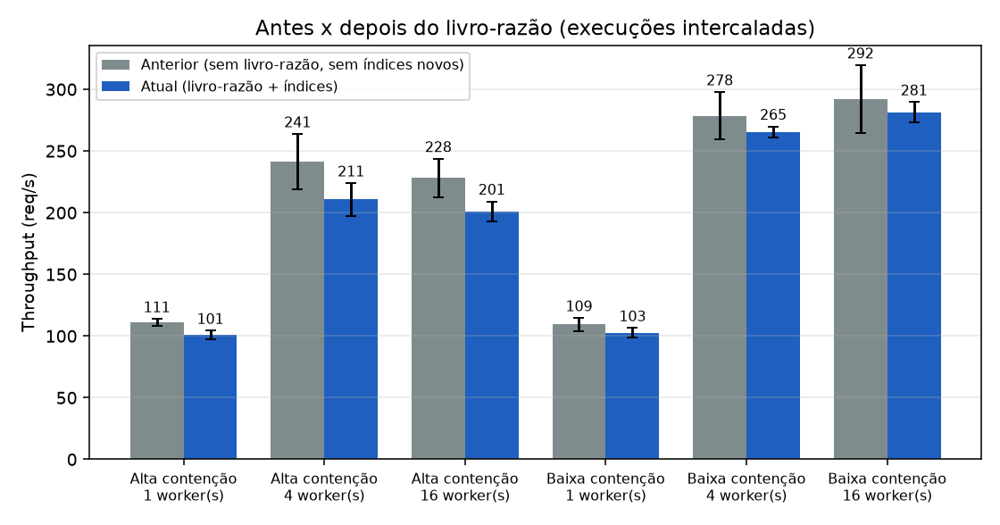

# Resultados do benchmark (gerado automaticamente)

## Ambiente

- **data**: 2026-10-28 23:38:57
- **python**: 3.13.12
- **so**: Windows-11-10.0.26200-SP0
- **processador**: AMD64 Family 25 Model 80 Stepping 0, AuthenticAMD
- **cpus_logicas**: 16
- **postgresql**: PostgreSQL 16.15 on x86_64-pc-linux-musl
- **postgres_em_docker**: sim (estoque_postgres|postgres:16-alpine|0.0.0.0:5432->5432/tcp, [::]:5432->5432/tcp)
- **pool_size**: 20
- **max_overflow**: 10
- **banco**: estoque_bench
- **parâmetros**: 1000 requisições, 50 materiais (baixa contenção), 5 execuções medidas + 1 de aquecimento, semente 42

## Comparação de versões (A/B intercalado): antes x depois do livro-razão

| Cenário | Workers | Anterior (req/s) | Atual (req/s) | Variação | Tempo anterior (s) | Tempo atual (s) | CPU anterior | CPU atual |
|---|--:|--:|--:|--:|--:|--:|--:|--:|
| Alta contenção | 1 | 111 ± 3 | 101 ± 4 | -9.1% | 9.02 | 9.92 | 41% | 40% |
| Alta contenção | 4 | 241 ± 22 | 211 ± 13 | -12.7% | 4.14 | 4.75 | 86% | 81% |
| Alta contenção | 16 | 228 ± 16 | 201 ± 8 | -11.9% | 4.38 | 4.98 | 83% | 79% |
| Baixa contenção | 1 | 109 ± 5 | 103 ± 4 | -6.2% | 9.14 | 9.74 | 40% | 42% |
| Baixa contenção | 4 | 278 ± 19 | 265 ± 5 | -4.7% | 3.59 | 3.77 | 94% | 97% |
| Baixa contenção | 16 | 292 ± 27 | 281 ± 8 | -3.7% | 3.42 | 3.55 | 98% | 98% |

## Gráficos

