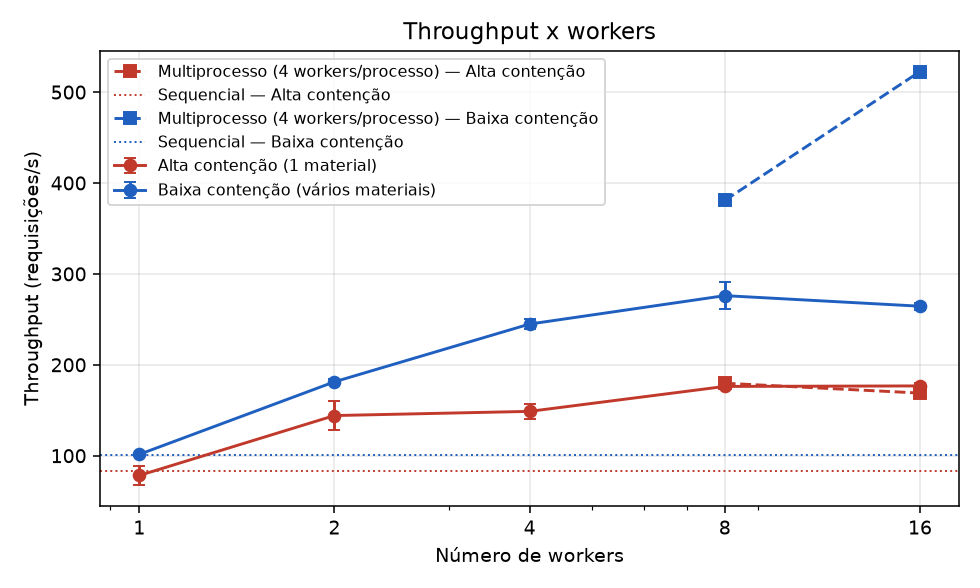
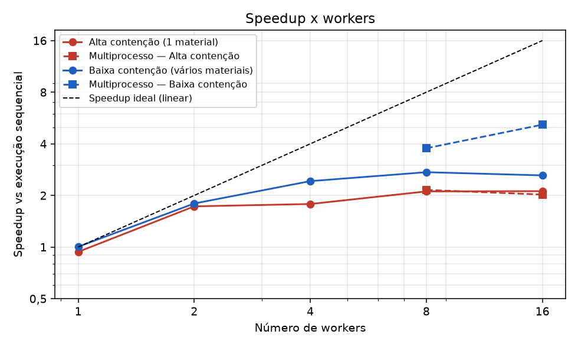
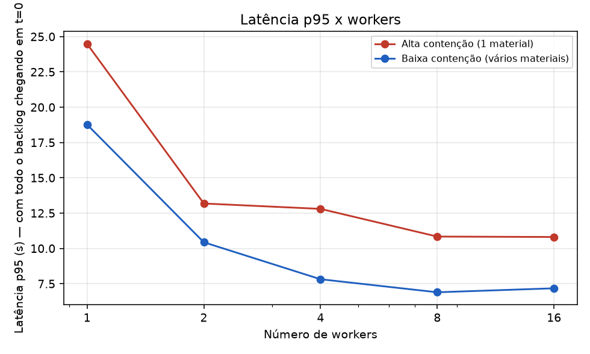
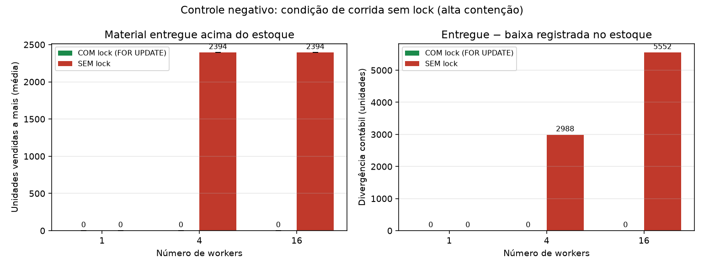
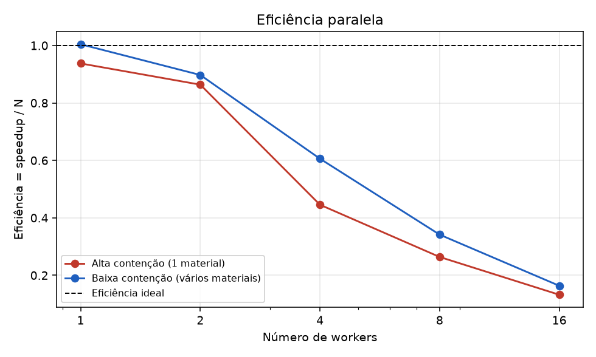

# Resultados do benchmark (gerado automaticamente)

## Ambiente

- **data**: 2026-10-28 22:17:47
- **python**: 3.13.12
- **so**: Windows-11-10.0.26200-SP0
- **processador**: AMD64 Family 25 Model 80 Stepping 0, AuthenticAMD
- **cpus_logicas**: 16
- **postgresql**: PostgreSQL 16.15 on x86_64-pc-linux-musl
- **postgres_em_docker**: sim (estoque_postgres|postgres:16-alpine|0.0.0.0:5432->5432/tcp, [::]:5432->5432/tcp)
- **pool_size**: 20
- **max_overflow**: 10
- **banco**: estoque_bench
- **parâmetros**: 2000 requisições, 50 materiais (baixa contenção), 5 execuções medidas + 1 de aquecimento, semente 42

## Alta contenção (1 material)

| Execução | Workers | T mediano (s) | Desvio (s) | Throughput (req/s) | p50 (ms) | p95 (ms) | p99 (ms) | Speedup vs sequencial | Eficiência | Speedup vs 1 worker | CPU do cliente | Invariantes |
|---|--:|--:|--:|--:|--:|--:|--:|--:|--:|--:|--:|:-:|
| Sequencial (sem fila/workers) | 1 | 23.96 | 3.67 | 83.5 | 11721 | 22649 | 23720 | 1.00 | — | — | 47% | OK |
| 1 processo, 1 worker(s) | 1 | 25.56 | 4.57 | 78.2 | 14157 | 24484 | 25332 | 0.94 | 0.94 | 1.00 | 38% | OK |
| 1 processo, 2 worker(s) | 2 | 13.87 | 1.67 | 144.2 | 6740 | 13180 | 13743 | 1.73 | 0.86 | 1.84 | 64% | OK |
| 1 processo, 4 worker(s) | 4 | 13.44 | 0.75 | 148.8 | 6996 | 12800 | 13260 | 1.78 | 0.45 | 1.90 | 67% | OK |
| 1 processo, 8 worker(s) | 8 | 11.35 | 0.15 | 176.2 | 6102 | 10838 | 11242 | 2.11 | 0.26 | 2.25 | 59% | OK |
| 1 processo, 16 worker(s) | 16 | 11.31 | 0.20 | 176.8 | 5996 | 10810 | 11209 | 2.12 | 0.13 | 2.26 | 61% | OK |
| 2 processos × 4 workers | 8 | 11.13 | 0.28 | 179.7 | 5894 | 10588 | 10994 | 2.15 | 0.27 | 2.30 | 72% | OK |
| 4 processos × 4 workers | 16 | 11.84 | 1.50 | 168.9 | 6323 | 11248 | 11695 | 2.02 | 0.13 | 2.16 | 74% | OK |

## Baixa contenção (vários materiais)

| Execução | Workers | T mediano (s) | Desvio (s) | Throughput (req/s) | p50 (ms) | p95 (ms) | p99 (ms) | Speedup vs sequencial | Eficiência | Speedup vs 1 worker | CPU do cliente | Invariantes |
|---|--:|--:|--:|--:|--:|--:|--:|--:|--:|--:|--:|:-:|
| Sequencial (sem fila/workers) | 1 | 19.80 | 1.78 | 101.0 | 10296 | 18912 | 19622 | 1.00 | — | — | 42% | OK |
| 1 processo, 1 worker(s) | 1 | 19.71 | 0.14 | 101.5 | 10283 | 18770 | 19488 | 1.00 | 1.00 | 1.00 | 44% | OK |
| 1 processo, 2 worker(s) | 2 | 11.03 | 0.17 | 181.3 | 5859 | 10435 | 10876 | 1.79 | 0.90 | 1.79 | 74% | OK |
| 1 processo, 4 worker(s) | 4 | 8.17 | 0.20 | 244.8 | 4408 | 7817 | 8081 | 2.42 | 0.61 | 2.41 | 97% | OK |
| 1 processo, 8 worker(s) | 8 | 7.24 | 0.40 | 276.1 | 3710 | 6894 | 7160 | 2.73 | 0.34 | 2.72 | 98% | OK |
| 1 processo, 16 worker(s) | 16 | 7.56 | 0.11 | 264.5 | 3958 | 7175 | 7492 | 2.62 | 0.16 | 2.61 | 98% | OK |
| 2 processos × 4 workers | 8 | 5.25 | 0.06 | 380.8 | 2693 | 4892 | 5074 | 3.77 | 0.47 | 3.75 | 189% | OK |
| 4 processos × 4 workers | 16 | 3.83 | 0.06 | 522.6 | 1945 | 3574 | 3699 | 5.17 | 0.32 | 5.15 | 362% | OK |

## Controle negativo: com lock x sem lock (alta contenção)

| Workers | Modo | Execuções com venda a mais | Unidades vendidas a mais (média ± dp) | Máximo | Divergência contábil média (un.) | Invariantes |
|--:|---|--:|--:|--:|--:|:-:|
| 1 | COM lock (FOR UPDATE) | 0/5 | 0.0 ± 0.0 | 0 | 0.0 | OK |
| 1 | SEM lock | 0/5 | 0.0 ± 0.0 | 0 | 0.0 | OK |
| 4 | COM lock (FOR UPDATE) | 0/5 | 0.0 ± 0.0 | 0 | 0.0 | OK |
| 4 | SEM lock | 5/5 | 2394.0 ± 0.0 | 2394 | 2987.6 | FALHOU em 5/5 |
| 16 | COM lock (FOR UPDATE) | 0/5 | 0.0 ± 0.0 | 0 | 0.0 | OK |
| 16 | SEM lock | 5/5 | 2394.0 ± 0.0 | 2394 | 5551.8 | FALHOU em 5/5 |

## Gráficos

