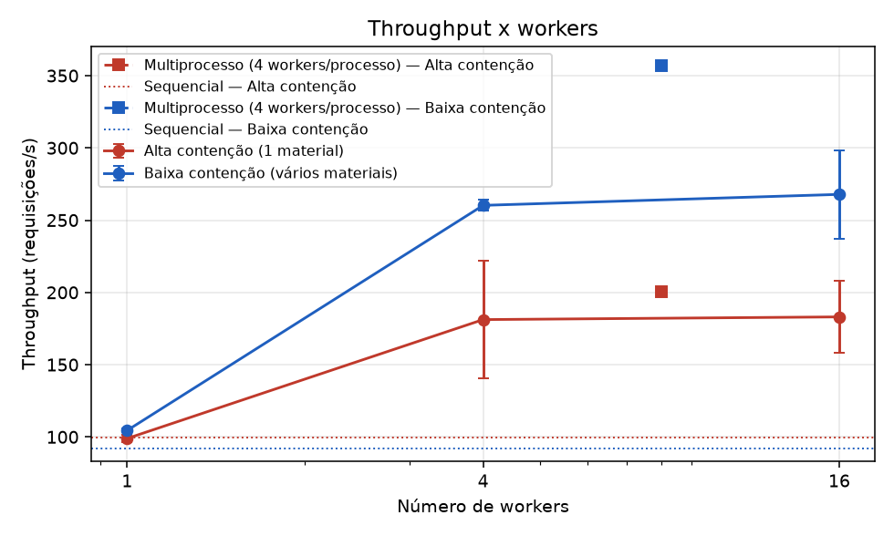
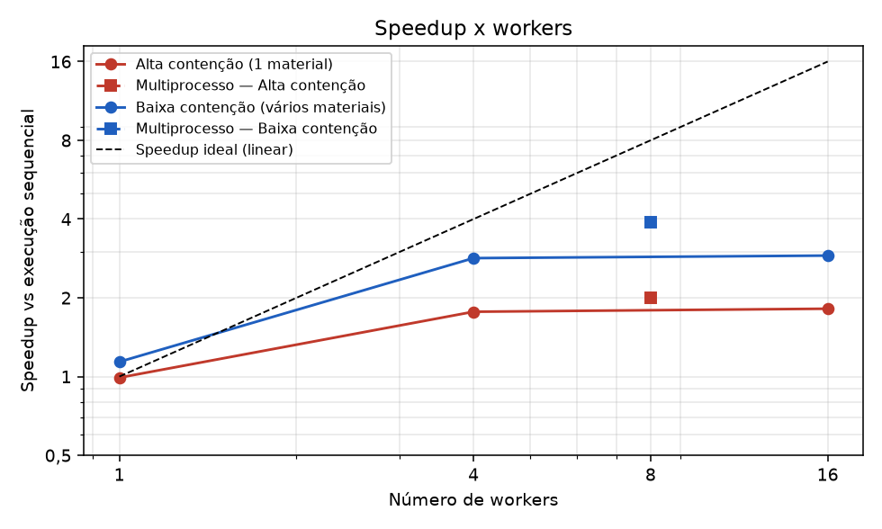
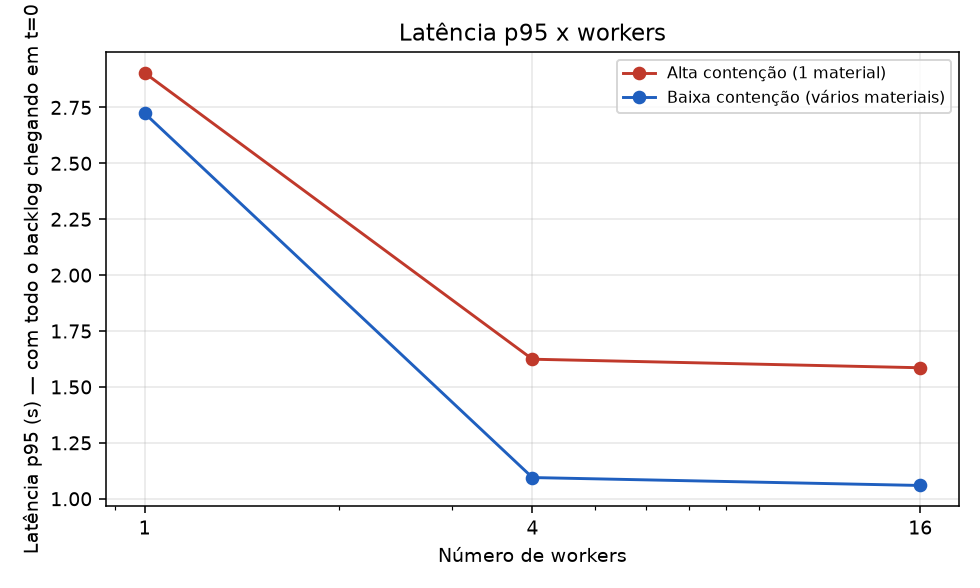
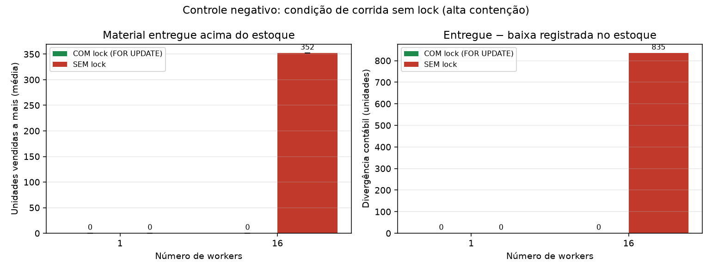
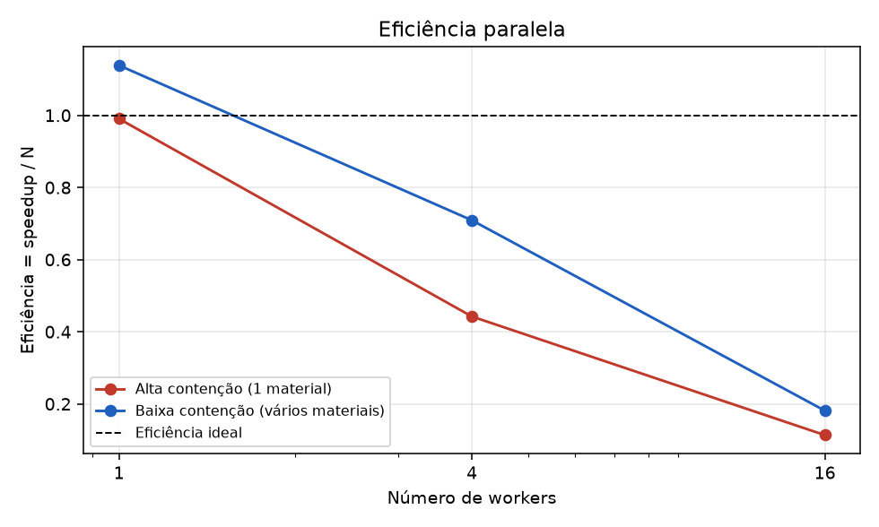

# Resultados do benchmark (gerado automaticamente)

## Ambiente

- **data**: 2026-10-28 23:35:17
- **python**: 3.13.12
- **so**: Windows-11-10.0.26200-SP0
- **processador**: AMD64 Family 25 Model 80 Stepping 0, AuthenticAMD
- **cpus_logicas**: 16
- **postgresql**: PostgreSQL 16.15 on x86_64-pc-linux-musl
- **postgres_em_docker**: sim (estoque_postgres|postgres:16-alpine|0.0.0.0:5432->5432/tcp, [::]:5432->5432/tcp)
- **pool_size**: 20
- **max_overflow**: 10
- **banco**: estoque_bench
- **parâmetros**: 300 requisições, 10 materiais (baixa contenção), 2 execuções medidas + 1 de aquecimento, semente 42

## Alta contenção (1 material)

| Execução | Workers | T mediano (s) | Desvio (s) | Throughput (req/s) | p50 (ms) | p95 (ms) | p99 (ms) | Speedup vs sequencial | Eficiência | Speedup vs 1 worker | CPU do cliente | Invariantes |
|---|--:|--:|--:|--:|--:|--:|--:|--:|--:|--:|--:|:-:|
| Sequencial (sem fila/workers) | 1 | 3.01 | 0.02 | 99.8 | 1635 | 2858 | 2975 | 1.00 | — | — | 41% | OK |
| 1 processo, 1 worker(s) | 1 | 3.03 | 0.08 | 98.9 | 1613 | 2904 | 3002 | 0.99 | 0.99 | 1.00 | 42% | OK |
| 1 processo, 4 worker(s) | 4 | 1.70 | 0.38 | 181.2 | 978 | 1624 | 1680 | 1.77 | 0.44 | 1.79 | 73% | OK |
| 1 processo, 16 worker(s) | 16 | 1.65 | 0.23 | 183.1 | 984 | 1586 | 1633 | 1.82 | 0.11 | 1.83 | 84% | OK |
| 2 processos × 4 workers | 8 | 1.50 | 0.00 | 200.4 | 848 | 1388 | 1437 | 2.01 | 0.25 | 2.03 | 87% | OK |

## Baixa contenção (vários materiais)

| Execução | Workers | T mediano (s) | Desvio (s) | Throughput (req/s) | p50 (ms) | p95 (ms) | p99 (ms) | Speedup vs sequencial | Eficiência | Speedup vs 1 worker | CPU do cliente | Invariantes |
|---|--:|--:|--:|--:|--:|--:|--:|--:|--:|--:|--:|:-:|
| Sequencial (sem fila/workers) | 1 | 3.27 | 0.23 | 92.0 | 1719 | 3110 | 3232 | 1.00 | — | — | 38% | OK |
| 1 processo, 1 worker(s) | 1 | 2.87 | 0.04 | 104.5 | 1571 | 2724 | 2832 | 1.14 | 1.14 | 1.00 | 43% | OK |
| 1 processo, 4 worker(s) | 4 | 1.15 | 0.02 | 260.2 | 635 | 1095 | 1133 | 2.84 | 0.71 | 2.49 | 94% | OK |
| 1 processo, 16 worker(s) | 16 | 1.13 | 0.13 | 267.8 | 611 | 1059 | 1105 | 2.90 | 0.18 | 2.55 | 99% | OK |
| 2 processos × 4 workers | 8 | 0.84 | 0.05 | 357.2 | 443 | 756 | 783 | 3.89 | 0.49 | 3.41 | 168% | OK |

## Controle negativo: com lock x sem lock (alta contenção)

| Workers | Modo | Execuções com venda a mais | Unidades vendidas a mais (média ± dp) | Máximo | Divergência contábil média (un.) | Invariantes |
|--:|---|--:|--:|--:|--:|:-:|
| 1 | COM lock (FOR UPDATE) | 0/2 | 0.0 ± 0.0 | 0 | 0.0 | OK |
| 1 | SEM lock | 0/2 | 0.0 ± 0.0 | 0 | 0.0 | OK |
| 16 | COM lock (FOR UPDATE) | 0/2 | 0.0 ± 0.0 | 0 | 0.0 | OK |
| 16 | SEM lock | 2/2 | 352.0 ± 0.0 | 352 | 835.0 | FALHOU em 2/2 |

## Gráficos

