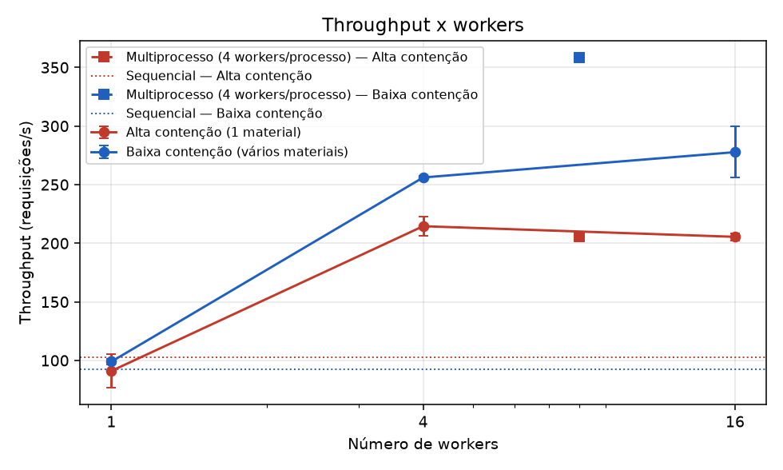
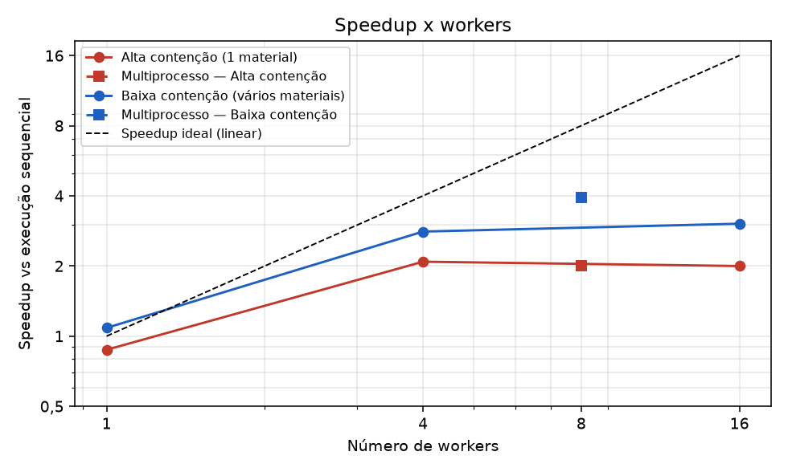
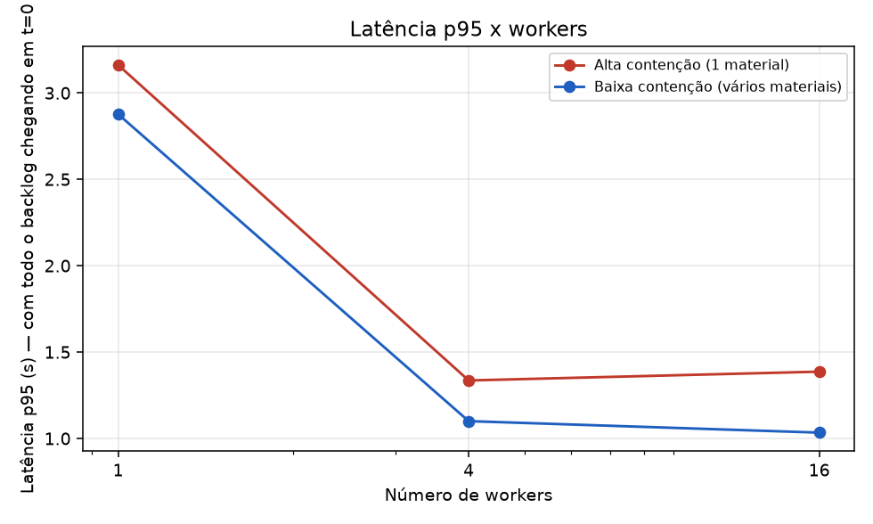
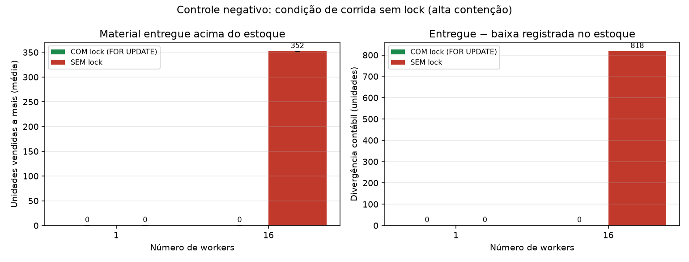
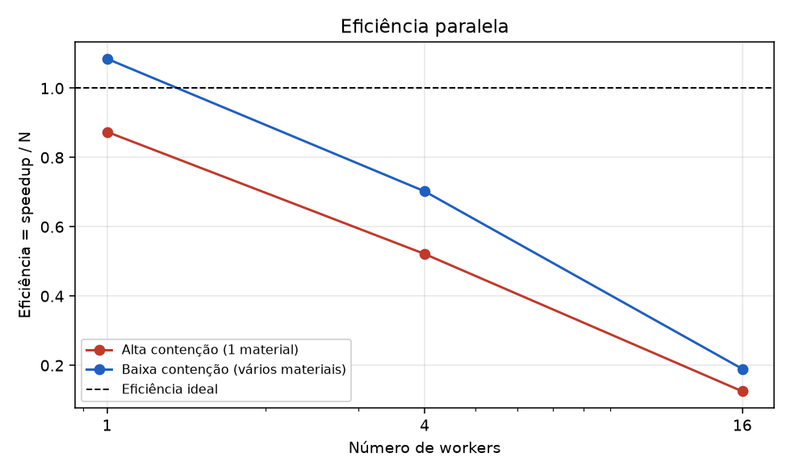

# Resultados do benchmark (gerado automaticamente)

## Ambiente

- **data**: 2026-10-28 23:03:53
- **python**: 3.13.12
- **so**: Windows-11-10.0.26200-SP0
- **processador**: AMD64 Family 25 Model 80 Stepping 0, AuthenticAMD
- **cpus_logicas**: 16
- **postgresql**: PostgreSQL 16.15 on x86_64-pc-linux-musl
- **postgres_em_docker**: sim (estoque_postgres|postgres:16-alpine|0.0.0.0:5432->5432/tcp, [::]:5432->5432/tcp)
- **pool_size**: 20
- **max_overflow**: 10
- **banco**: estoque_bench
- **parâmetros**: 300 requisições, 10 materiais (baixa contenção), 2 execuções medidas + 1 de aquecimento, semente 42

## Alta contenção (1 material)

| Execução | Workers | T mediano (s) | Desvio (s) | Throughput (req/s) | p50 (ms) | p95 (ms) | p99 (ms) | Speedup vs sequencial | Eficiência | Speedup vs 1 worker | CPU do cliente | Invariantes |
|---|--:|--:|--:|--:|--:|--:|--:|--:|--:|--:|--:|:-:|
| Sequencial (sem fila/workers) | 1 | 2.92 | 0.02 | 102.8 | 1536 | 2780 | 2887 | 1.00 | — | — | 39% | OK |
| 1 processo, 1 worker(s) | 1 | 3.34 | 0.53 | 91.0 | 1653 | 3162 | 3290 | 0.87 | 0.87 | 1.00 | 44% | OK |
| 1 processo, 4 worker(s) | 4 | 1.40 | 0.05 | 214.5 | 756 | 1336 | 1381 | 2.09 | 0.52 | 2.39 | 82% | OK |
| 1 processo, 16 worker(s) | 16 | 1.46 | 0.02 | 205.5 | 798 | 1387 | 1438 | 2.00 | 0.12 | 2.29 | 84% | OK |
| 2 processos × 4 workers | 8 | 1.46 | 0.03 | 205.8 | 767 | 1351 | 1390 | 2.00 | 0.25 | 2.29 | 94% | OK |

## Baixa contenção (vários materiais)

| Execução | Workers | T mediano (s) | Desvio (s) | Throughput (req/s) | p50 (ms) | p95 (ms) | p99 (ms) | Speedup vs sequencial | Eficiência | Speedup vs 1 worker | CPU do cliente | Invariantes |
|---|--:|--:|--:|--:|--:|--:|--:|--:|--:|--:|--:|:-:|
| Sequencial (sem fila/workers) | 1 | 3.29 | 0.50 | 92.2 | 1685 | 3152 | 3257 | 1.00 | — | — | 44% | OK |
| 1 processo, 1 worker(s) | 1 | 3.03 | 0.07 | 98.9 | 1589 | 2877 | 2999 | 1.08 | 1.08 | 1.00 | 41% | OK |
| 1 processo, 4 worker(s) | 4 | 1.17 | 0.01 | 256.1 | 631 | 1100 | 1143 | 2.81 | 0.70 | 2.59 | 95% | OK |
| 1 processo, 16 worker(s) | 16 | 1.08 | 0.09 | 277.7 | 536 | 1034 | 1069 | 3.04 | 0.19 | 2.80 | 100% | OK |
| 2 processos × 4 workers | 8 | 0.84 | 0.04 | 358.7 | 422 | 740 | 770 | 3.93 | 0.49 | 3.62 | 183% | OK |

## Controle negativo: com lock x sem lock (alta contenção)

| Workers | Modo | Execuções com venda a mais | Unidades vendidas a mais (média ± dp) | Máximo | Divergência contábil média (un.) | Invariantes |
|--:|---|--:|--:|--:|--:|:-:|
| 1 | COM lock (FOR UPDATE) | 0/2 | 0.0 ± 0.0 | 0 | 0.0 | OK |
| 1 | SEM lock | 0/2 | 0.0 ± 0.0 | 0 | 0.0 | OK |
| 16 | COM lock (FOR UPDATE) | 0/2 | 0.0 ± 0.0 | 0 | 0.0 | OK |
| 16 | SEM lock | 2/2 | 352.0 ± 0.0 | 352 | 817.5 | FALHOU em 2/2 |

## Gráficos

