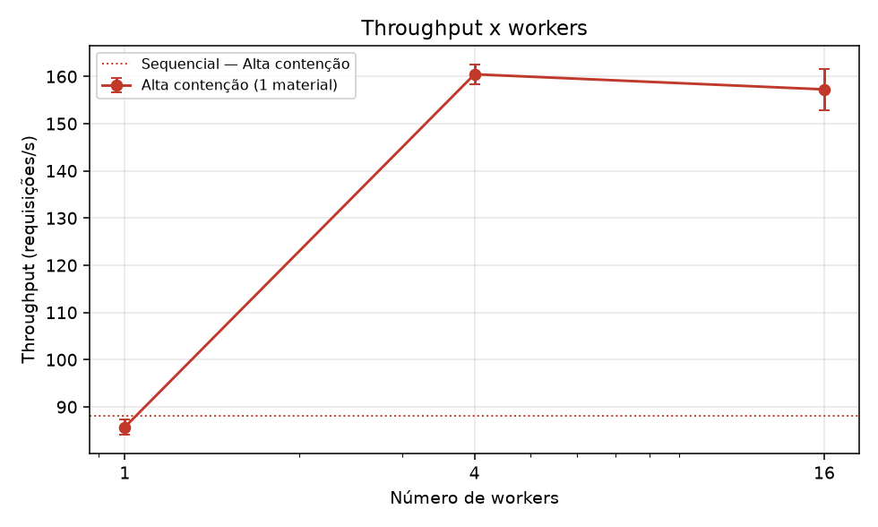
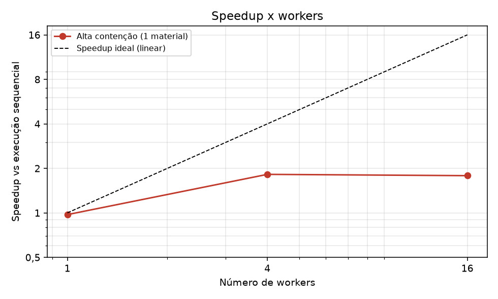
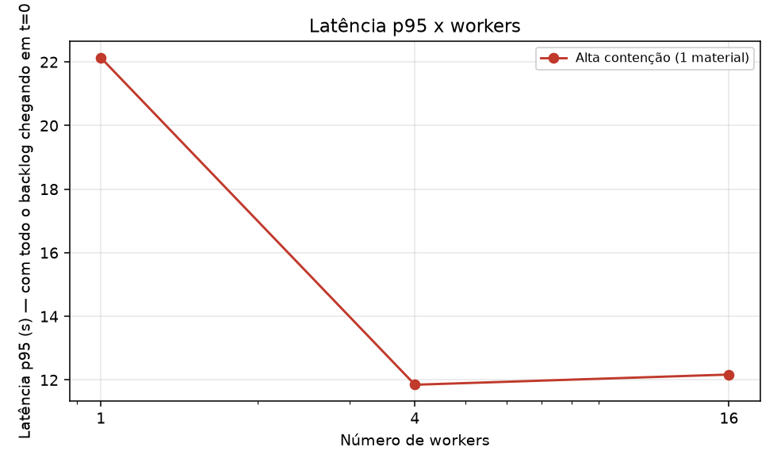
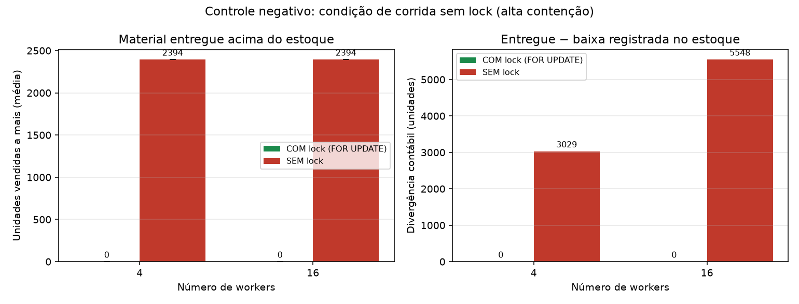
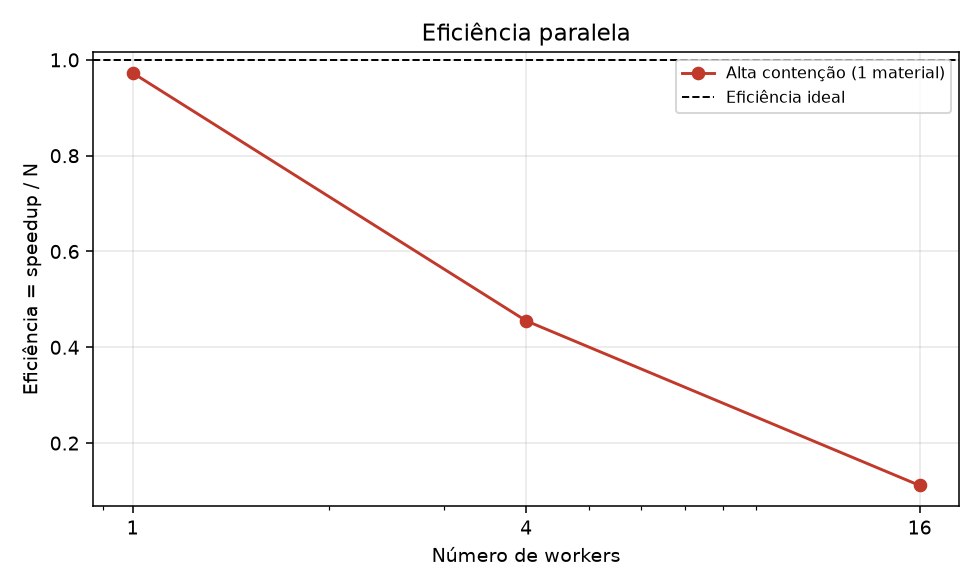

# Resultados do benchmark (gerado automaticamente)

## Ambiente

- **data**: 2026-10-28 22:49:12
- **python**: 3.13.12
- **so**: Windows-11-10.0.26200-SP0
- **processador**: AMD64 Family 25 Model 80 Stepping 0, AuthenticAMD
- **cpus_logicas**: 16
- **postgresql**: PostgreSQL 16.15 on x86_64-pc-linux-musl
- **postgres_em_docker**: sim (estoque_postgres|postgres:16-alpine|0.0.0.0:5432->5432/tcp, [::]:5432->5432/tcp)
- **pool_size**: 20
- **max_overflow**: 10
- **banco**: estoque_bench
- **parâmetros**: 2000 requisições, 50 materiais (baixa contenção), 5 execuções medidas + 1 de aquecimento, semente 42

## Alta contenção (1 material)

| Execução | Workers | T mediano (s) | Desvio (s) | Throughput (req/s) | p50 (ms) | p95 (ms) | p99 (ms) | Speedup vs sequencial | Eficiência | Speedup vs 1 worker | CPU do cliente | Invariantes |
|---|--:|--:|--:|--:|--:|--:|--:|--:|--:|--:|--:|:-:|
| Sequencial (sem fila/workers) | 1 | 22.70 | 1.85 | 88.1 | 11482 | 21652 | 22500 | 1.00 | — | — | 36% | OK |
| 1 processo, 1 worker(s) | 1 | 23.33 | 0.45 | 85.7 | 12259 | 22132 | 23073 | 0.97 | 0.97 | 1.00 | 38% | OK |
| 1 processo, 4 worker(s) | 4 | 12.46 | 0.17 | 160.5 | 6626 | 11849 | 12320 | 1.82 | 0.46 | 1.87 | 62% | OK |
| 1 processo, 16 worker(s) | 16 | 12.72 | 0.36 | 157.3 | 6786 | 12169 | 12604 | 1.78 | 0.11 | 1.83 | 65% | OK |

## Controle negativo: com lock x sem lock (alta contenção)

| Workers | Modo | Execuções com venda a mais | Unidades vendidas a mais (média ± dp) | Máximo | Divergência contábil média (un.) | Invariantes |
|--:|---|--:|--:|--:|--:|:-:|
| 4 | COM lock (FOR UPDATE) | 0/5 | 0.0 ± 0.0 | 0 | 0.0 | OK |
| 4 | SEM lock | 5/5 | 2394.0 ± 0.0 | 2394 | 3029.0 | FALHOU em 5/5 |
| 16 | COM lock (FOR UPDATE) | 0/5 | 0.0 ± 0.0 | 0 | 0.0 | OK |
| 16 | SEM lock | 5/5 | 2394.0 ± 0.0 | 2394 | 5547.6 | FALHOU em 5/5 |

## Gráficos

