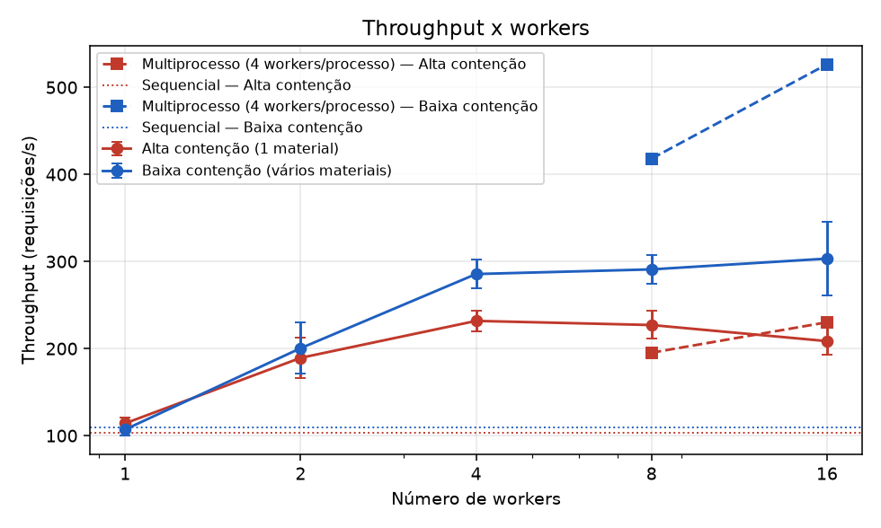
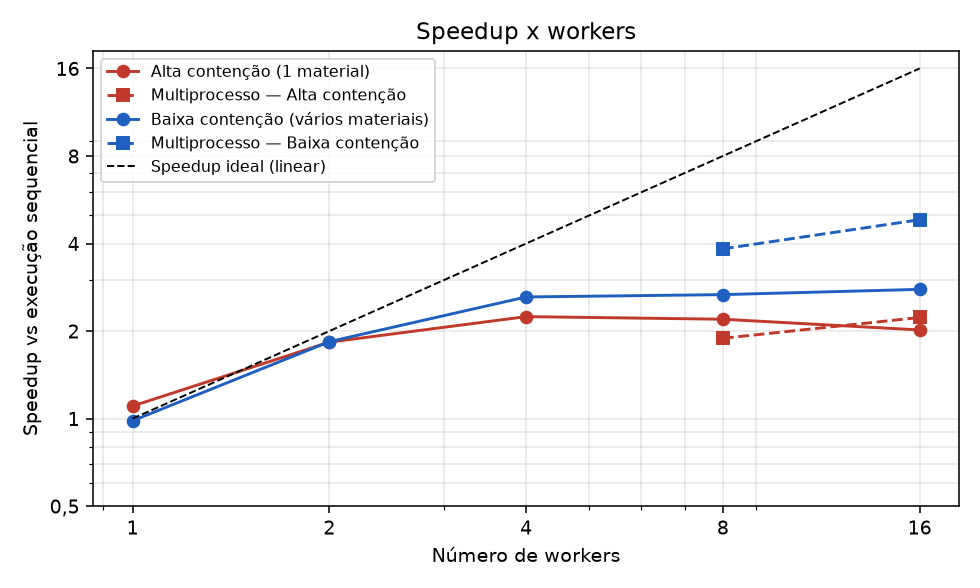
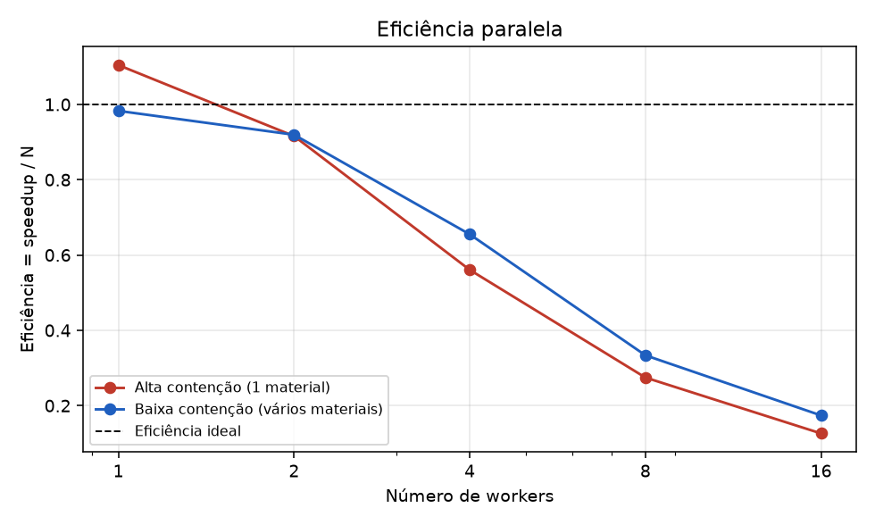
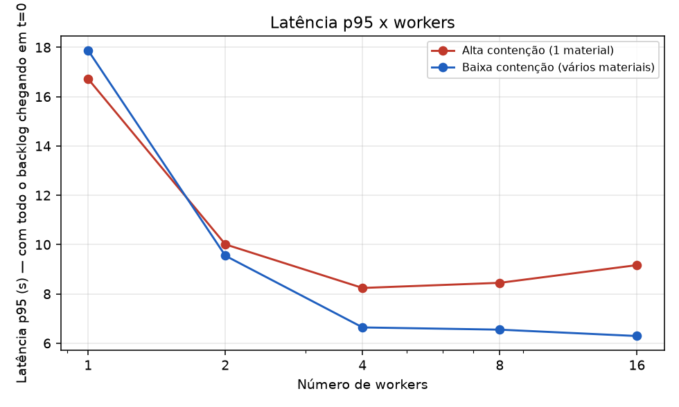
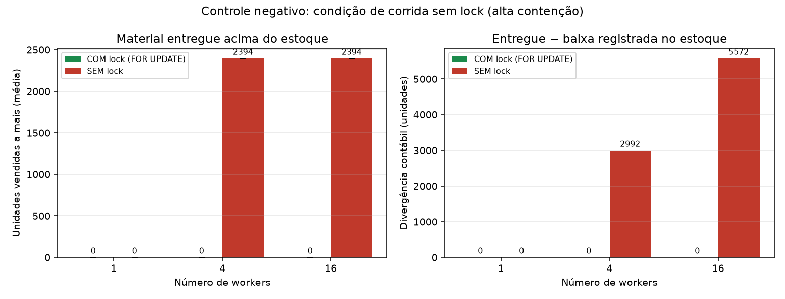
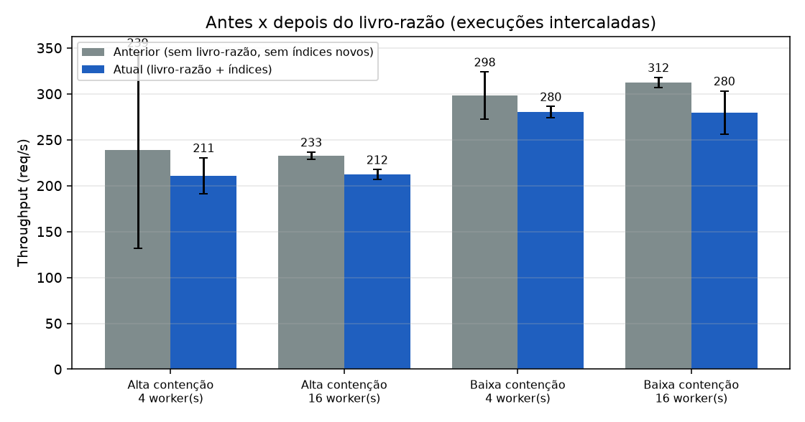

# Benchmark de concorrência do motor de alocação de estoque

> Evidência para "testes" e "otimização demonstrável". Todos os números abaixo foram **gerados** por
> `python -m benchmarks.bench_concorrencia` (CSV bruto em `benchmarks/resultados/resultados.csv`); nada foi digitado à mão.
> Os resultados são **desta máquina** (ver [Ambiente](#3-ambiente)) e **não** devem ser lidos como desempenho de produção.

## 1. Objetivo
Responder, com medições, três perguntas:

1. **Executar vários workers ajuda?** Quanto, e até quando (speedup e eficiência)?
2. **De onde vem o ganho — e onde ele acaba?** Concorrência assíncrona (asyncio) ou paralelismo real em vários núcleos?
3. **O lock pessimista é necessário e quanto custa?** (controle negativo: o mesmo processamento **sem** `FOR UPDATE`).

## 2. Metodologia

**O que é medido.** Só o motor: fila de prioridade + `worker_loop` reais (`app/services/fila_service.py`) +
`processar_requisicao` (`SELECT … FOR UPDATE`) + PostgreSQL. O benchmark **não usa a fila global nem a camada HTTP**: cada
execução cria a sua `FilaRequisicoes`, enfileira **todas** as requisições *antes* de iniciar os workers (backlog completo em t=0) e
só então sobe N `worker_loop`. O banco é `estoque_bench` (nunca o de desenvolvimento) e usa **o mesmo engine/pool da aplicação**
(`pool_size=20`, `max_overflow=10`).

**Cenários** (mesma semente, `random.Random(42)`, portanto mesma carga em todas as configurações):

| Cenário | Materiais | Requisições | Intuição |
|---|---|---|---|
| **Alta contenção** | 1 | 2000 | todos os workers disputam a **mesma linha** |
| **Baixa contenção** | 50 | 2000 | a disputa se espalha por 50 linhas |

10 obras com prioridades/prazos distintos (2 "paradas"), quantidades de 1 a 5. O estoque de cada material é **60 % da demanda**
dele, então há parciais e negadas e os invariantes são exercitados de verdade.

**Configurações:** baseline **sequencial** (mesmas requisições, na ordem de prioridade, num único laço, sem fila/workers);
**1 processo** com 1, 2, 4, 8 e 16 workers; **multiprocesso** (2 e 4 processos × 4 workers, cada um com a sua fila e uma
partição disjunta das requisições, como `uvicorn --workers N`); e o **controle negativo**.

**Execuções intercaladas (decisão metodológica importante).** Cada configuração roda **5 vezes mais 1 de aquecimento descartada**,
mas as execuções são **intercaladas**: em cada rodada, *todas* as configurações rodam uma vez, em ordem aleatória (semente fixa).
Isso foi necessário porque o desempenho desta máquina muda de fase ao longo de minutos (ver [seção 6](#6-validade-a-deriva-do-ambiente)).
Reportamos **mediana e desvio padrão** das 5 execuções.

**Métricas por execução**

| Métrica | Definição |
|---|---|
| Tempo total | do início dos workers até a última requisição sair de `PENDENTE`/`EM_PROCESSAMENTO` |
| Throughput | requisições ÷ tempo total |
| Latência p50/p95/p99 | `processado_em − t0` por requisição, com **todo o backlog chegando em t=0**. Logo p95 ≈ 0,95·T: é um espelho do tempo total, **não** a latência de um sistema com chegadas espalhadas |
| Speedup | T(sequencial) ÷ T(N). Também reportado contra 1 worker |
| Eficiência | speedup ÷ N |
| CPU do cliente | `process_time / tempo` (soma dos processos): 100 % = 1 núcleo inteiro |
| Invariantes | estoque final ≥ 0; **conservação por material**: inicial = final + Σ atendido; nenhuma requisição aberta ou em erro |

**Controle negativo** (`benchmarks/sem_lock.py`, nunca importado por `app/`): o mesmo processamento (inclusive o registro da
saída no livro-razão) **sem** `with_for_update()`, lendo e depois escrevendo. Roda sob a mesma carga, no mesmo laço de workers.
Reportamos *unidades vendidas a mais* (por material, quanto saiu além do que existia) e a *divergência contábil*
(entregue − baixa registrada no estoque).

## 3. Ambiente

| Item | Valor |
|---|---|
| Python | 3.13.12 |
| Sistema | Windows-11-10.0.26200-SP0 |
| Processador | AMD64 Family 25 Model 80 Stepping 0, AuthenticAMD, 16 CPUs lógicas |
| PostgreSQL | PostgreSQL 16.15 on x86_64-pc-linux-musl |
| Postgres em Docker | sim (estoque_postgres|postgres:16-alpine|0.0.0.0:5432->5432/tcp, [::]:5432->5432/tcp) |
| Pool do engine | `pool_size=20`, `max_overflow=10` (30 conexões no total) |
| Bibliotecas | SQLAlchemy 2.0.35 (asyncio), asyncpg 0.30.0 |
| Parâmetros | 2000 requisições, 50 materiais (baixa contenção), 5 execuções + 1 de aquecimento, semente 42 |
| Data | 2026-10-28 23:05:59 |

Cliente (Python) e servidor (Postgres no contêiner) rodam **na mesma máquina**, sem isolamento de outros processos do Windows.

## 4. Resultados

### 4.1 Alta contenção (1 material, 2000 requisições)

| Execução | Workers | T mediano (s) | Desvio (s) | Throughput (req/s) | p50 (ms) | p95 (ms) | p99 (ms) | Speedup vs sequencial | Eficiência | Speedup vs 1 worker | CPU do cliente | Invariantes |
|---|--:|--:|--:|--:|--:|--:|--:|--:|--:|--:|--:|:-:|
| Sequencial (sem fila/workers) | 1 | 19.35 | 1.33 | 103.4 | 9944 | 18433 | 19146 | 1.00 | — | — | 42% | OK |
| 1 processo, 1 worker(s) | 1 | 17.52 | 1.03 | 114.2 | 9122 | 16718 | 17359 | 1.10 | 1.10 | 1.00 | 42% | OK |
| 1 processo, 2 worker(s) | 2 | 10.56 | 1.57 | 189.3 | 5250 | 10008 | 10448 | 1.83 | 0.92 | 1.66 | 72% | OK |
| 1 processo, 4 worker(s) | 4 | 8.63 | 0.46 | 231.8 | 4626 | 8241 | 8551 | 2.24 | 0.56 | 2.03 | 84% | OK |
| 1 processo, 8 worker(s) | 8 | 8.81 | 0.64 | 227.0 | 4808 | 8449 | 8736 | 2.20 | 0.27 | 1.99 | 84% | OK |
| 1 processo, 16 worker(s) | 16 | 9.59 | 0.66 | 208.6 | 5207 | 9168 | 9476 | 2.02 | 0.13 | 1.83 | 83% | OK |
| 2 processos × 4 workers | 8 | 10.24 | 2.14 | 195.2 | 5381 | 9667 | 10085 | 1.89 | 0.24 | 1.71 | 104% | OK |
| 4 processos × 4 workers | 16 | 8.69 | 2.61 | 230.2 | 4891 | 8287 | 8581 | 2.23 | 0.14 | 2.02 | 114% | OK |

### 4.2 Baixa contenção (50 materiais, 2000 requisições)

| Execução | Workers | T mediano (s) | Desvio (s) | Throughput (req/s) | p50 (ms) | p95 (ms) | p99 (ms) | Speedup vs sequencial | Eficiência | Speedup vs 1 worker | CPU do cliente | Invariantes |
|---|--:|--:|--:|--:|--:|--:|--:|--:|--:|--:|--:|:-:|
| Sequencial (sem fila/workers) | 1 | 18.35 | 1.72 | 109.0 | 9614 | 17507 | 18169 | 1.00 | — | — | 42% | OK |
| 1 processo, 1 worker(s) | 1 | 18.67 | 1.26 | 107.1 | 10041 | 17874 | 18496 | 0.98 | 0.98 | 1.00 | 42% | OK |
| 1 processo, 2 worker(s) | 2 | 9.98 | 2.08 | 200.4 | 5145 | 9547 | 9887 | 1.84 | 0.92 | 1.87 | 73% | OK |
| 1 processo, 4 worker(s) | 4 | 7.00 | 0.43 | 285.6 | 3624 | 6640 | 6926 | 2.62 | 0.65 | 2.67 | 96% | OK |
| 1 processo, 8 worker(s) | 8 | 6.87 | 0.43 | 290.9 | 3525 | 6549 | 6784 | 2.67 | 0.33 | 2.72 | 98% | OK |
| 1 processo, 16 worker(s) | 16 | 6.59 | 1.25 | 303.3 | 3497 | 6291 | 6513 | 2.78 | 0.17 | 2.83 | 98% | OK |
| 2 processos × 4 workers | 8 | 4.78 | 0.42 | 418.1 | 2413 | 4503 | 4664 | 3.84 | 0.48 | 3.90 | 193% | OK |
| 4 processos × 4 workers | 16 | 3.80 | 0.41 | 526.5 | 1910 | 3519 | 3660 | 4.83 | 0.30 | 4.91 | 361% | OK |

### 4.3 Controle negativo: com lock × sem lock (alta contenção)

| Workers | Modo | Execuções com venda a mais | Unidades vendidas a mais (média ± dp) | Máximo | Divergência contábil média (un.) | Invariantes |
|--:|---|--:|--:|--:|--:|:-:|
| 1 | COM lock (FOR UPDATE) | 0/5 | 0.0 ± 0.0 | 0 | 0.0 | OK |
| 1 | SEM lock | 0/5 | 0.0 ± 0.0 | 0 | 0.0 | OK |
| 4 | COM lock (FOR UPDATE) | 0/5 | 0.0 ± 0.0 | 0 | 0.0 | OK |
| 4 | SEM lock | 5/5 | 2394.0 ± 0.0 | 2394 | 2991.6 | FALHOU em 5/5 |
| 16 | COM lock (FOR UPDATE) | 0/5 | 0.0 ± 0.0 | 0 | 0.0 | OK |
| 16 | SEM lock | 5/5 | 2394.0 ± 0.0 | 2394 | 5572.4 | FALHOU em 5/5 |

No controle, o **estoque total** é 3 590 unidades e a demanda 5 984. Com o lock, as 2000 requisições entregam exatamente 3 590 (em
15 de 15 execuções). Sem o lock, a partir de 4 workers **todas as 2000 foram aprovadas**: 5 984 unidades entregues contra 3 590 em
estoque, isto é, **2 394 unidades vendidas a mais em 10 de 10 execuções** — o valor satura em "demanda − estoque" porque sem lock
*nada* é negado. A **divergência contábil** (o quanto o estoque registrado diverge do que foi entregue) cresce com a concorrência:
≈ 2 992 unidades com 4 workers e ≈ 5 572 com 16. Com 1 worker não há corrida (0).

### 4.4 Gráficos






## 5. Análise

### 5.1 Quanto os workers ajudam
* O **baseline sequencial** faz ≈ 103–109 req/s (≈ 9–10 ms por requisição) e usa só **42 % de um núcleo**: o resto é espera de rede/banco.
  Cada requisição faz várias idas ao PostgreSQL, e é esse tempo ocioso que os workers aproveitam.
* **Baixa contenção:** 1 → 2 → 4 workers dá 1,8× → 2,6× (eficiência 0,92 → 0,65); com 8–16 o ganho para em ≈ 2,7–2,8×, e a **CPU do cliente chega a
  96–98 %**: o processo único esgotou um núcleo.
* **Alta contenção:** o pico é 2,2× com 4 workers (232 req/s); com 8 e 16 workers o throughput **não melhora e até cai um pouco**
  (227 e 209 req/s). Mais workers só aumentam a fila de espera pelo mesmo lock.
* Em nenhum caso a eficiência é alta além de 2 workers: **a escalabilidade é fortemente sublinear**, e acrescentar workers além de ~4 num único
  processo não compensa (eficiência 0,13–0,17 com 16).

### 5.2 Concorrência assíncrona × paralelismo real
Aqui está o ponto central para a monografia:

* **Concorrência (asyncio, 1 processo).** Os workers são *corrotinas* num único thread. Enquanto uma espera a resposta do
  PostgreSQL, outra executa. Isso **sobrepõe esperas de I/O**: é a causa do ganho de 1 → 4 workers (a CPU sobe de 42 % para 84–96 %).
  Ela **não usa mais de um núcleo** (GIL e um único event loop): quando o thread satura (baixa contenção, CPU ≈ 98 %), mais workers não ajudam.
* **Paralelismo (vários processos).** Cada processo tem o seu event loop e usa o seu núcleo. Na **baixa contenção**, 2 processos × 4 workers
  chegam a 3,8× (418 req/s) e 4 × 4 a **4,8× (526 req/s)**, com a CPU do cliente em 193 % e 361 %: **+38 % e +74 %** sobre o melhor
  resultado de um processo só (303 req/s). Aqui o paralelismo real ajuda, porque o gargalo era a CPU do cliente.
  Mesmo assim a eficiência é de 0,30–0,48 (não é linear): sobram outros limites que **não foram isolados** (o próprio
  PostgreSQL, a rede Docker↔Windows, as 30 conexões do pool).
* **Alta contenção.** Multiprocesso **não ajuda** (1,9× com 2 processos e 2,2× com 4, dentro do ruído do pico de 1 processo, com
  desvio de até 2,6 s). O gargalo não é o cliente: é a **linha do material**, que só uma transação por vez pode alterar. Processos
  extras apenas disputam o mesmo lock.

| Situação | O que ajuda | Por quê |
|---|---|---|
| Muita espera de I/O, pouca disputa | **concorrência** (4–8 workers por processo) | sobrepõe esperas de rede/banco |
| Cliente (CPU) saturado, pedidos em materiais diferentes | **paralelismo** (mais processos) | cada processo usa um núcleo |
| Muitos pedidos para o **mesmo** material | **nenhum dos dois** além do ponto de pico | serialização na linha; só reduzir o tempo da seção crítica ajudaria |

### 5.3 O lock é necessário e custa pouco perto do que protege
* **Necessário:** sem `FOR UPDATE` a corrida aparece já com 4 workers (seção 4.3): 2 394 unidades entregues além do estoque e um saldo registrado
  que não bate com o que saiu. Com o lock: 0 em 15 de 15 execuções, e os invariantes passaram em **todas** as execuções.
* **Custo:** com 4 e 16 workers o processamento sem lock foi ≈ 22 % e ≈ 14 % mais rápido (266 × 219 e 246 × 217 req/s). É o preço da
  correção. Note que **remover o lock explícito não eliminou a serialização**: o `UPDATE` da mesma linha continua exigindo que as
  transações esperem uma pela outra no PostgreSQL; o `FOR UPDATE` apenas faz isso mais cedo e mantém a decisão ("há estoque?")
  dentro da seção protegida. Essa leitura é uma **hipótese coerente com os dados**, não foi isolada por um experimento próprio.

### 5.4 Por que a alta contenção satura em ≈ 230 req/s
A seção crítica de cada pedido (do `SELECT … FOR UPDATE` ao `COMMIT`) envolve várias idas ao banco e é exclusiva para aquele material:
≈ 4,3 ms por requisição a ≈ 232 req/s. Isso é **consistente** com o teto observado e com o fato de multiprocessos e mais workers não o
elevarem. A CPU do cliente em alta contenção (≈ 84 %) também está alta, então **os dois limites estão próximos** e esta medição não
os separa com certeza.

### 5.5 Latência
Como todo o backlog chega em t=0, o p95 da tabela é praticamente 95 % do tempo total (por exemplo ≈ 8,2 s com T = 8,6 s). Ele **não**
mede a espera de um sistema com pedidos chegando aos poucos; serve apenas para confirmar que a distribuição de término é
aproximadamente uniforme e que reduzir T reduz a latência na mesma proporção.

## 6. Validade: a deriva do ambiente
A primeira execução completa rodou cada configuração **em bloco** (todas as execuções de uma configuração, depois a próxima).
O resultado era incoerente: a mesma carga (1 material, 4 workers) deu **149 req/s** na série de workers e **216 req/s** no controle com lock.
Investigação:

1. Uma verificação independente repetiu o fenômeno (160 × 218 req/s), com variação mínima *dentro* de cada bloco.
2. Um teste A/B intercalado mostrou que o `worker_loop` de produção, o laço genérico, o laço com `logger.info` e o laço lendo atributos rendem
   o mesmo (≈ 220–265 req/s): **o código não era a causa**.
3. Nesse mesmo teste todas as variantes caíram juntas de ≈ 265 para ≈ 180–230 req/s entre rodadas: o desempenho da máquina
   (Windows + Docker + sincronização de pasta) **muda de fase ao longo de minutos**.

Se as configurações rodam em bloco, essa deriva se mistura com o efeito do número de workers. Por isso o benchmark passou a **intercalar** as
configurações (rodada = todas as configurações, ordem sorteada). Com isso a mesma comparação ficou coerente:

| Alta contenção, 4 workers | Em blocos (descartada) | Intercalada (usada aqui) |
|---|--:|--:|
| `worker_loop` de produção | 149 req/s | **232 req/s** |
| Controle (com lock, mesmo processamento) | 216 req/s | **219 req/s** |

Os resultados em blocos ficam arquivados em `benchmarks/resultados/execucao_em_blocos/` e a verificação em
`benchmarks/resultados/verificacao_deriva/`, como evidência. **Conclusão metodológica:** nesta máquina, comparar configurações medidas em momentos
diferentes pode errar em dezenas de por cento; só são confiáveis as comparações feitas dentro da mesma execução intercalada.

## 7. Antes e depois do livro-razão (registro de movimentações)
A etapa de relatórios acrescentou **duas coisas ao caminho crítico**: (a) `processar_requisicao` agora grava uma `MovimentacaoEstoque`
(SAÍDA) **na mesma transação** do débito, depois da decisão e do débito, sem mudar regra, lock nem ordem; e (b) quatro índices novos em
`requisicoes` (`status`, `criado_em`, `obra_id`, `material_id`). Como medir isso sem cair na deriva da seção 6?
Comparando **A/B intercalado**, na mesma execução:

* **Anterior** = cópia congelada do `processar_requisicao` de antes (`benchmarks/versao_anterior.py`) **sem** os índices novos;
* **Atual** = o `processar_requisicao` de produção **com** os índices;
* (2ª medição) **Atual sem índices novos**, para separar o custo do `INSERT` do custo dos índices.

1 000 requisições por execução, 5 execuções + 1 de aquecimento, mediana ± desvio.

**1ª medição** (workers 1, 4 e 16):

| Cenário | Workers | Anterior (req/s) | Atual (req/s) | Variação | Tempo anterior (s) | Tempo atual (s) | CPU anterior | CPU atual |
|---|--:|--:|--:|--:|--:|--:|--:|--:|
| Alta contenção | 1 | 111 ± 3 | 101 ± 4 | -9.1% | 9.02 | 9.92 | 41% | 40% |
| Alta contenção | 4 | 241 ± 22 | 211 ± 13 | -12.7% | 4.14 | 4.75 | 86% | 81% |
| Alta contenção | 16 | 228 ± 16 | 201 ± 8 | -11.9% | 4.38 | 4.98 | 83% | 79% |
| Baixa contenção | 1 | 109 ± 5 | 103 ± 4 | -6.2% | 9.14 | 9.74 | 40% | 42% |
| Baixa contenção | 4 | 278 ± 19 | 265 ± 5 | -4.7% | 3.59 | 3.77 | 94% | 97% |
| Baixa contenção | 16 | 292 ± 27 | 281 ± 8 | -3.7% | 3.42 | 3.55 | 98% | 98% |

**2ª medição** (com a decomposição; workers 4 e 16):

| Cenário | Workers | Anterior (req/s) | Atual (req/s) | Variação | Tempo anterior (s) | Tempo atual (s) | CPU anterior | CPU atual | Atual sem índices novos (req/s) | Variação só do INSERT |
|---|--:|--:|--:|--:|--:|--:|--:|--:|--:|--:|
| Alta contenção | 4 | 239 ± 107 | 211 ± 20 | -11.7% | 4.19 | 4.75 | 81% | 81% | 219 ± 3 | -8.0% |
| Alta contenção | 16 | 233 ± 4 | 212 ± 5 | -8.8% | 4.30 | 4.71 | 80% | 77% | 213 ± 38 | -8.7% |
| Baixa contenção | 4 | 298 ± 26 | 280 ± 6 | -6.0% | 3.35 | 3.57 | 96% | 96% | 268 ± 12 | -10.2% |
| Baixa contenção | 16 | 312 ± 6 | 280 ± 24 | -10.5% | 3.20 | 3.57 | 98% | 98% | 287 ± 8 | -8.2% |



**Leitura honesta:**
* A versão atual é **mais lenta em todas as 10 comparações**, de **−3,7 % a −12,7 %** (típico ≈ −9 %). Há regressão **mensurável**, não nula.
* Com 1 worker (sem disputa) o custo é ≈ **+0,6 a +0,9 ms por requisição** (9,0 → 9,9 s por 1 000), compatível com **uma ida a mais ao banco**: o `INSERT`.
* Tirando os índices novos, o código atual continua **−8 % a −10 %** mais lento que o anterior: **o `INSERT` explica quase tudo**; o custo dos
  índices **não se distingue do ruído** (as diferenças entre "atual" e "atual sem índices" vão de −4 % a +5 %, com sinais mistos).
* Na **alta contenção** o `INSERT` fica **dentro da seção crítica** do lock do material, alongando-a: o teto cai de ≈ 233–241 para ≈ 211 req/s (≈ −9 a −12 %).
  Na **baixa contenção** o efeito é menor ou comparável (−4 a −10 %), porque o gargalo é a CPU do cliente e o `INSERT` é um comando a mais por requisição.
* O desvio é grande em algumas células (por exemplo ± 107 no "anterior", alta contenção, 4 workers, por uma execução discrepante); por isso usamos a **mediana**
  e só tiramos conclusões do sinal consistente entre as 10 comparações, não de uma célula isolada.
* **Julgamento:** é o custo esperado de ter um livro-razão auditável gravado atomicamente com o débito (a alternativa, gravar fora da
  transação, perderia a garantia "estoque inicial + entradas − saídas = atual"). Nenhuma invariante foi afetada (os testes de conservação sob
  concorrência passam). Se a perda de ≈ 9 % incomodar, a otimização candidata é **fundir a SAÍDA ao débito em um único comando SQL** (um
  `UPDATE … RETURNING` com CTE que também insere a movimentação), eliminando a ida extra ao banco. **Não foi aplicada**
  (mexeria mais na lógica crítica) e fica registrada em `docs/achados.md`.

**`--rapido` antes × depois** (pedido da etapa): as mesmas configurações curtas (300 requisições, 2 execuções) rodadas com o código anterior
(`benchmarks/resultados/rapido_antes_do_livro_razao/`) e com o atual (`benchmarks/resultados/rapido/`):

| Cenário | Configuração | Antes (req/s) | Depois (req/s) | Variação |
|---|---|--:|--:|--:|
| Alta | sequencial | 103 | 100 | −2,9 % |
| Alta | 1 worker | 91 | 99 | +8,7 % |
| Alta | 4 workers | 215 | 181 | −15,5 % |
| Alta | 16 workers | 205 | 183 | −10,9 % |
| Alta | com lock, 16 workers | 188 | 208 | +10,6 % |
| Alta | 2 processos × 4 | 206 | 200 | −2,6 % |
| Baixa | sequencial | 92 | 92 | −0,3 % |
| Baixa | 1 worker | 99 | 104 | +5,6 % |
| Baixa | 4 workers | 256 | 260 | +1,6 % |
| Baixa | 16 workers | 278 | 268 | −3,6 % |
| Baixa | 2 processos × 4 | 359 | 357 | −0,4 % |

Com apenas 2 execuções por configuração e as duas rodadas medidas em momentos diferentes, essa tabela tem **ruído de ±10–15 %** (note
as variações positivas, que não têm explicação causal) e **não prova nem desmente** a regressão. Ela serve para confirmar que **nada quebrou**
(invariantes OK, ordem de grandeza igual); a medida confiável da diferença é o A/B intercalado acima.


## 8. Limitações
* **Uma máquina, Windows + contêiner Linux do Postgres.** A rede entre cliente e banco passa pela camada do Docker no Windows; em Linux nativo
  ou em um servidor dedicado os números absolutos (e talvez os limites) seriam outros. Cliente e servidor competem pelos mesmos núcleos.
* **Sem isolamento** de outros processos; o projeto fica em uma pasta sincronizada pelo OneDrive. A deriva descrita na seção 6 mostra que há
  ruído grande. Usamos 5 execuções, mediana e desvio, mas o desvio chega a 2,6 s (multiprocesso em alta contenção); diferenças menores que ≈ 10 % **não devem ser interpretadas**.
* **Carga sintética:** quantidades de 1 a 5, 10 obras, estoque a 60 % da demanda, semente 42. Outras distribuições podem mudar os números.
* **Só o motor.** Não inclui HTTP, autenticação (bcrypt), serialização JSON nem o navegador; a API real terá menos throughput que o motor.
* **Latência de backlog** (definição na seção 2), não de chegadas espalhadas.
* **Pool de 30 conexões:** 32 workers **não foram medidos** (o script aceita `--workers 1,2,4,8,16,32`); acima de 30, workers esperariam conexão.
* **Multiprocesso com partições disjuntas** de requisições por processo: é o que uma arquitetura correta precisaria garantir; o sistema atual
  **não** tem esse mecanismo (ver `docs/achados.md`, itens 1 e 2).
* A hipótese sobre a serialização do `UPDATE` (5.3) e o teto da seção 5.4 são interpretações compatíveis com os dados, não foram isoladas.
* O limite de ≈ 4,8× no multiprocesso em baixa contenção não foi investigado (Postgres? rede? pool?).

## 9. Conclusão
1. **Concorrência assíncrona ajuda, mas pouco e por pouco tempo.** Vários workers em um processo sobrepõem esperas de I/O e dão
   **≈ 2,2× (alta contenção) a ≈ 2,8× (baixa)** sobre o laço sequencial, com pico em ≈ 4–8 workers; depois disso o processo único satura (CPU ≈ 98 %) ou o lock da linha limita.
2. **Paralelismo real ajuda onde o gargalo é a CPU do cliente** (pedidos em materiais diferentes): 4 processos chegaram a **4,8×** (526 req/s).
   **Não ajuda quando o gargalo é a linha de um único material** (alta contenção): nada passou de ≈ 2,2×.
3. **O lock pessimista é indispensável.** Sem ele, 4 workers já entregaram 2 394 unidades a mais do que o estoque, com saldo contábil divergente; com ele, 0 violações em
   todas as execuções, a um custo de ≈ 14–22 % de throughput.
4. **A eficiência paralela é baixa** (0,13–0,65 acima de 2 workers). Para ganhar mais, o caminho não é "mais workers": é **reduzir a seção crítica**
   (menos idas ao banco por requisição) e **espalhar a carga** entre processos com partições disjuntas — ambos candidatos a trabalhos futuros, mensuráveis com este mesmo benchmark.

## 10. Como reproduzir
```powershell
docker compose up -d
.\venv\Scripts\Activate.ps1
pip install -r requirements-dev.txt
python -m benchmarks.bench_concorrencia --rapido     # ~2 min
python -m benchmarks.bench_concorrencia              # ~30 min; gera CSV, resumo.md e gráficos
python -m benchmarks.relatorio                       # regenera resumo.md e gráficos a partir do CSV
```
Não rode `pytest` nem outros programas pesados durante o benchmark (competem pelo mesmo Postgres e pelos mesmos núcleos).
